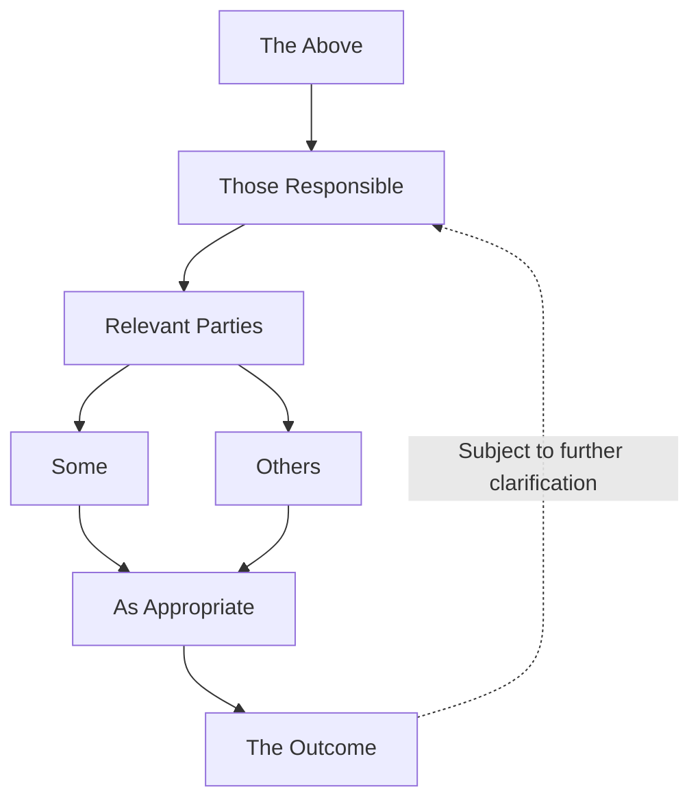

# The Hierarchy of Something™

*A deliberately vague organizational flowchart.*

**Authority:** Implied.  
**Accountability:** Distributed.  
**Decision-making:** Somewhere.  
**Oversight:** Presumably.

*Organizational structure approved by an unspecified entity.*
